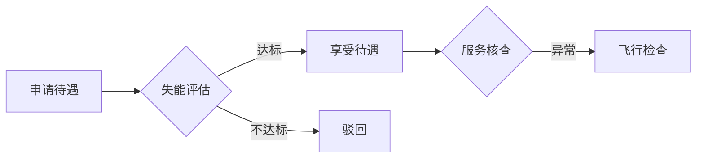

# 长护险"三假"治理观察：从假评估、假服务、假失能到全链条监管重构

> 作者：雄雄的小课堂

长期护理保险全面建制在即，制度快速铺开的另一面，是基金安全压力的同步放大。本文梳理"三假"及其延伸造假形态，并观察监管体系的系统性重构。

## 一、制度扩面与基金安全的双重命题

长期护理保险自 2016 年启动试点，历经十年发展，截至 2026 年已覆盖 92 个地区、3.08 亿人口，累计基金支出超 1000 亿元，惠及 330 余万失能人员。2026 年 3 月，国家医保局等 8 部门联合印发《加快建立长期护理保险制度实施方案》，明确到 2028 年底基本实现全国覆盖。


但制度快速铺开的另一面，是基金安全压力的同步放大。2026 年 3 月 26 日，国家医保局待遇保障司负责人张西凡在国新办新闻发布会上，首次公开将长护险领域的欺诈骗保行为归纳为"三假"——假评估、假服务、假失能，明确将其纳入长期护理保险专项检查范围。而实际情况比这三类更复杂，造假行为已不局限于此，身份冒用、资质伪造、数据篡改、跨部门信息壁垒的恶意利用等问题，在部分地区均有出现。


## 二、"三假"核心形态解析


### 假评估

假评估是造假链条的起点，直接决定谁能进入待遇享受体系。常见做法包括：评估机构对临界案例刻意放宽标准，评估人员与申请者串通在量表上作虚假记录，甚至将不符合标准的参保人"运作"进重度失能范畴。

这一环节之所以难以根治，原因并不复杂。评估人员单次入户，缺乏后续跟踪，评估结论又直接关联服务资格和基金支付，天然存在信息不对称。再加上各地评估标准本身就有差异，同一失能程度在不同地区可能获得不同认定，客观上也为虚假评估提供了操作空间。

### 假服务

假服务是基金流失最直接的通道。手法已经相当成熟："只打卡不服务"，护理员通过定位打卡或拍照完成签到后便离开；伪造服务记录，在确认单上捏造服务内容和时长；"违规从事家务"，以护理为名做的是打扫卫生、买菜做饭，却按护理标准收费。

实践中，护理员与失能人员家属串通的情形并不少见，借用他人证件、虚拟定位、远程打卡、虚增工时等手段层出不穷。问题的根子在于场景：居家护理发生在失能人员家中，监管人员不可能实时在场，而服务提供方和接受方之间很容易形成默契，共同维护服务"真实发生"的假象。

### 假失能

假失能的指向更明确，就是非法获取待遇资格。主要分两类：一是冒用他人身份骗取待遇，比如使用已故参保人证件；二是参保人失能状态已经改善或根本没达标，却隐瞒真实情况继续申领。

更棘手的是第三种情形：参保人、家属与评估机构或服务机构形成合谋，在整个链条中制造虚假信息闭环。有的参保人在住院期间申报长护险，隐瞒正在接受医疗护理的事实，重复获取保障。这类造假一旦形成闭环，仅靠单一环节的核查很难识破。

## 三、"三假"之外的造假延伸

### 假身份与假材料

身份盗用和材料造假构成欺诈的源头。通过提供虚假病历、诊断书、身份证件等申请待遇，或冒用他人失能评估材料申报、冒名接受护理服务。值得警惕的是，材料造假已经链条化，从纸质材料到电子数据，从签字盖章到影像留存，各环节都有对应的套路，监管识别难度大幅增加。

### 假机构与假人员

部分机构通过虚构场地、伪造资质、挂靠经营等方式获取定点资格，本身不具备服务能力，纯粹是套取基金的壳子。护理人员方面，2025 年全国长期照护师突破 1 万人，但从业人员总量达 37 万，持证率仍然很低。部分护理员证书系伪造或买卖所得，存在"人证分离"现象，证书只是应对检查的道具，持证人从不实际提供服务。


### 假数据与假协调

数字化转型带来了新的造假空间。机构通过伪造或篡改服务记录、护理日志、评估报告等电子文档制造假象，出现"挂空单"现象：系统里有完整的记录和结算流水，但服务从未真正发生。

还有一类更隐蔽的造假，是利用部门间的信息壁垒。长护险涉及医保、民政、卫健、残联等多个部门的数据，部分骗保者利用部门间信息同步不及时、数据标准不统一的漏洞，在一个部门已经丧失资格后，仍然通过另一个部门继续申领。

## 四、深层成因分析

"三假"问题能够滋生蔓延，背后有几层原因交织。


1. **制度本身的缝隙。** 长护险规则体系仍在完善中，评估标准各地不一、待遇水平区域分化、服务内容边界模糊，都给造假留下了空间。护理服务专业性强但标准化程度低，质量难以量化评估，假服务因此有了藏身之处。
2. **供需两端的利益驱动。** 对机构而言，定点资格意味着稳定客源和持续现金流；对失能人员或家属而言，待遇意味着照护负担的实质减轻。当供需双方都有造假动机，甚至形成利益同盟时，监管要穿透这层默契就非常困难。
3. **监管能力跟不上。** 传统的人海战术在长护险领域明显力不从心，服务对象分散、场景多元、居家护理私密性强，全程在场监管不现实，事后核查又面临取证难、认定难、追溯难。
4. **违法成本偏低。** 相较于造假可能带来的收益，过去的惩戒力度不足以形成震慑。2026 年 4 月 1 日《医疗保障基金使用监督管理条例实施细则》施行后，法律依据更加明确，但执行层面能否真正"长出牙齿"，还需要时间检验。

## 五、监管体系的系统性重构

### 技术赋能

2026 年国家医保局将"人工智能 + 医保监管"作为核心方向，构建事前提醒、事中审核、事后监管的"三道防线"。


在地方实践中，部分地区已探索出"线上 + 线下"协同监管模式：线下巡查组按月核查核心服务指标，线上通过移动端由家属实时上传护理过程影像与满意度评价，运用 OCR 等技术自动归档数据，对服务真实性进行交叉验证。

更前沿的尝试是将无接触感知技术引入监管。通过毫米波雷达等设备，实时监测失能人员在床时长、离床行为、生命体征等数据，动态核验失能等级的真实性；同时追踪护理人员的服务轨迹、时长和具体动作，通过大数据分析识别违规行为。这类技术正在改变监管逻辑，使"抽样检查"逐步让位于"全程覆盖"，"被动核查"逐步让位于"主动预警"。

### 制度协同

八部门方案明确要求"建立健全基金监管体系，完善欺诈骗保惩戒机制"。长护险监管不再是医保部门一家的事，民政、卫健、公安、司法等部门正在被纳入联动体系。在协议管理层面，定点机构的基金使用主体责任被进一步压实，超出执业许可范围开展服务或以伪造资料骗取基金的，将中止或解除服务协议并列入行业黑名单。


### 信用体系建设

部分地区已率先出台长期护理保险信用管理办法，将虚假评估、虚报服务、冒名顶替、骗取保险金等行为纳入违规记录，建立覆盖机构、人员、参保人的信用评价体系。信用等级与检查频次、绩效考核挂钩，信用低的机构面临更高频次的飞行检查，其护理人员可能被限制参与长护险服务。这种差异化监管，让有限的监管资源集中到风险最高的对象上。

### 法律强化

《医疗保障基金使用监督管理条例实施细则》明确了骗保行为认定标准和处罚措施。个人骗保面临追回违规费用、暂停医保支付资格、行政处罚乃至刑事责任；定点机构组织骗保的，面临解除协议、暂停执业、罚款等处罚，情节严重的移送公安机关。细则中还设置了"退出定点前的检查机制"：机构申请解除协议的，须经全面核查处理完毕后方可解除，堵住了过去"主动退出以逃避追责"的漏洞。

### 信息化支撑

国家医保信息平台已上线长期护理保险子系统，支持失能等级评估、定点管理、费用结算等全流程信息化管理，实现服务线上派单、上门服务智能定位、服务过程轨迹记录等功能。更重要的是，系统打通了与民政、卫健等部门的数据对接，推动失能评估与医疗数据互认，压缩了信息壁垒被恶意利用的空间。

## 六、仍待解决的问题

隐私保护与监管效能之间存在张力。毫米波雷达、热成像等技术虽然避免了摄像头的直接侵犯，但仍涉及行为轨迹、生命体征等敏感信息的采集。政策方向已经明确，但操作标准仍需细化。

基层监管能力是另一个瓶颈。2028 年底前要实现全国覆盖，但部分欠发达地区医保部门人员编制有限、专业能力不足，面对智能监管系统可能出现"有设备、没人会用"的尴尬。

监管力度本身也需要把握分寸。过度严苛可能产生"误伤"：机构因怕违规而把大量时间花在留痕上，压缩了实际服务时间。防骗保和保服务之间，需要找到一个合理的平衡点。

此外，长护险与工伤保险护理费、残疾人护理补贴等政策之间的待遇衔接问题也尚未解决。在信息共享不充分的情况下，"多头申领"仍然有空间存在，建立全国统一的待遇申领信息比对平台，是堵住这个漏洞的关键一步。

## 七、写在最后

长护险欺诈已经不是简单的"三假"能概括的了，它涉及身份、资质、数据、跨部门信息利用等多个环节。监管体系也在随之调整：智能技术正在替代人工抽查，多部门联动正在替代医保单打独斗，全链条治理正在替代事后追缴。

2026 年是长护险全面推开的起步之年，留给制度建设的窗口期只有 3 年。说到底，监管的目的不是让所有人都不敢动，而是让真正需要护理的人能拿到保障，让想钻空子的人没有空子可钻。这两件事同时做好，才是真正的难处。

> 本文作者：**雄雄的小课堂**。关注公众号，获取更多长护险政策解读。

---

## 附：mdlook 排版特性演示

> 以下内容用于展示编辑器支持的 Markdown 语法与公众号排版能力，正式使用时可整段删除。

### 文本、列表与任务

支持 **加粗**、*斜体*、~~删除线~~、`行内代码`，以及[超链接](https://md.doocs.org)。

- 无序列表项
- 支持多级嵌套
  - 子项一
  - 子项二

1. 有序列表项一
2. 有序列表项二

- [x] 已完成的任务
- [ ] 待办的任务

### 引用与警告块

> 普通引用：用于强调原文或补充说明。

> [!NOTE]
> 一般提示信息，适合放注意事项。

> [!TIP]
> 小技巧：选中文字后可在工具栏快速加粗、插入链接。

> [!IMPORTANT] 发布前必读
> 正文支持完整的 **Markdown** 与公式 $E=mc^2$。

### 表格

| 监管环节 | 主要手段           | 难点         |
| -------- | ------------------ | ------------ |
| 假评估   | 放宽标准、串通记录 | 信息不对称   |
| 假服务   | 只打卡不服务       | 场景难监管   |
| 假失能   | 冒用身份、隐瞒改善 | 链条化闭环   |

### 代码高亮

```js
// 计算长护险基金支出占比
function payoutRatio(payout, total) {
  return ((payout / total) * 100).toFixed(2) + `%`
}

console.log(payoutRatio(1000, 3080)) // "32.47%"
```

### 数学公式（KaTeX）

行内公式：失能率 $r = \dfrac{n_{\text{失能}}}{N_{\text{参保}}}$。

块级公式：

$$
\text{基金可持续性} = \frac{\sum \text{缴费} + \text{财政补贴}}{\sum \text{待遇支出} + \text{管理成本}}
$$

### 流程图（Mermaid）



### 横屏滑动幻灯片

使用 `<,>` 语法可创建公众号横屏滑动，建议使用相似尺寸的图片：

<,,>
